# YOLO11 Object Detection Project Issue 067 - UAV Aerial Photography of Clover Flowers Detection System Based on YOLO11 (Dataset + Source Code Model + UI Interface)

UAV aerial photography and clover flower detection practical system based on YOLOv11. Data phase 1.1 Data set preparation for UAV aerial photography and clover flower detection dataset is an...

# **UAV Aerial Photography and Detection of Clover Flowers Based on YOLOv11 System**

## 1. Data phase

### 1.1 Data Set Preparation

The UAV aerial photography dataset for detection of alfalfa flowers is a dataset used for target detection tasks. Its main application areas include **intelligent monitoring/precision management of alfalfa flower production quality/development of intelligent detection algorithms**. The example is shown in the following figure:

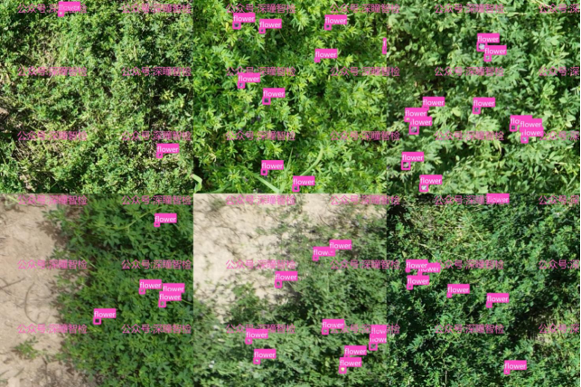

Background: **Alfalfa** is a high-quality legume forage that plays a crucial role in the development of livestock farming, soil fertility enhancement, and ecological restoration in the northwest agricultural-pastoral zones of China. The Ningxia Yellow River Irrigation Area, with its abundant irrigation water resources and suitable climate conditions, has become one of the core areas for the large-scale planting of alfalfa. The blooming period of alfalfa is a critical stage in its growth cycle, directly affecting seed yield, forage nutritional content, and subsequent harvest arrangements. Traditional dynamic monitoring of alfalfa blooming relies on manual inspection, which is not only time-consuming and labor-intensive, but also has subjectivity, limited coverage, and other issues, making it difficult to meet the needs of precise management of large-scale grasslands. With the integration of drone technology and artificial intelligence, crop phenotype monitoring based on drone aerial photography images has become a trend. However, the lack of systematic, multi-scene alfalfa flowering image datasets has become a bottleneck restricting the development of intelligent systems in this field.

Dataset Details: This dataset consists of **real drone aerial images of field scenes**. The images are collected based on real-world drone aerial photography of field scenes, captured under various lighting conditions, different times, and locations. They are labeled using the Roboflow tool and YOLO format. The dataset contains approximately **5000 high-quality PNG images in YOLO format**, accompanied by corresponding txt label files, each corresponding to one image. The labeling format is uniformly YOLO-style, divided into training set, validation set, and test set at an approximate ratio of 8:1:1 for easy training and comparative testing of YOLO series algorithms. The data categories mainly cover common core typical categories such as **flowers**, etc.

1.2 Data Set Structure Organization

The YOLO format dataset structure is as follows:

**uav_alfalfa_flower_det_data/******

**- images******

**-- train******

**-- val******

**-- test******

**- labels******

**-- train******

**-- val******

**-- test******

The training set contains approximately **4000** high-quality png images, the validation set approximately **500** high-quality png images, and the test set approximately **500** high-quality png images.

### 1.3 Data Set Download

[Note: Prepare the **uav_alfalfa_flower_det_data** folder, which should be in the same directory level as the following project, Yolov11_det. Do not place the **uav_alfalfa_flower_det_data** folder inside the project.]

☆ You can directly obtain the converted Yolo format dataset (as mentioned later) by **seeing the end of the document**.

### 1.4 Environmental Installation

Execute the following instructions:

pip install ultralytics==8.3.59 -i https://pypi.tuna.tsinghua.edu.cn/simple

## 2. Training phase

### 2.1 Configuration File Modifications

[Prerequisites: CUDA, torch, and ultralytics versions must match and be available, using the pre-trained model of Yolo11n]

[Need to enter the project "yolov11_det"]

Modify the data configuration file ./custom.yaml, set the training and validation sets paths, ensure there is a consistent number of categories and category names.

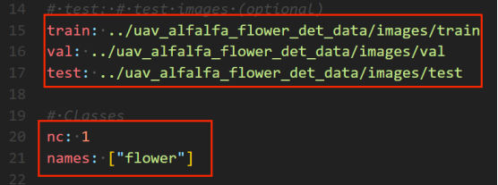

### 2.2 Execute Training Commands

Modify the training parameters in the train.py file as needed, such as: for Windows systems, set workers to 0; for Linux systems, set it to 8; other parameters should be modified according to hardware configuration requirements.

Execute training instructions:

python train.py

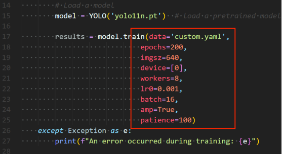

After training 200 epochs (with early stopping mechanism, 200 epochs), the model is saved in the runs/detect/train/weights folder.

### 2.3 Training the Generated Results File

1) Core model

**weights/******

Store the trained model weights, which are the core output of training.

best.pt: Optimal model weights for validation set performance (e.g., mAP, loss) recommended for actual deployment.

last.pt: The final model weights at the end of training (potentially overfitted, not recommended for direct use).

2) Training configuration

**args.yaml******

Record all hyperparameters and configurations during training (such as model type, epochs, learning rate, dataset path, image size, etc.) for reproducing the training process or viewing parameter settings.

3) Logging

**events.out.tfevents.*******

TensorBoard log file, recording loss, mAP, learning rate and other indicators during training/validation. Visualize the training curve through tensorboard --logdir run/detect/train.

**results.csv******

Record the key metrics of each training round in CSV format (such as epoch, train/box_loss, val/mAP50, etc.), which can be used for Excel or script analysis of training trends.

### **2.4 Evaluation and Visualization Results**

1) F1_curve.png (F1 score)

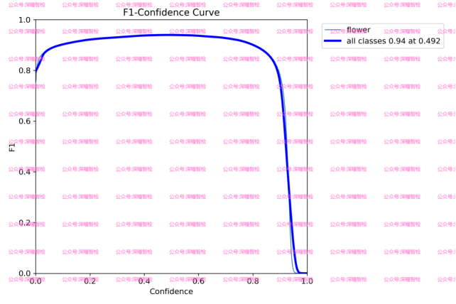

From the figure, it can be seen that when the confidence is fixed at a certain value, the F1 score of all_classes reaches its **maximum**; this indicates that the model performs well in predicting classes with this confidence level and has a certain degree of accuracy and recall.

What is the F1 score? The F1 score is the harmonic mean of precision and recall, taking into account both the accuracy of model predictions and their coverage.

2) P_curve.png (Accuracy Curve)

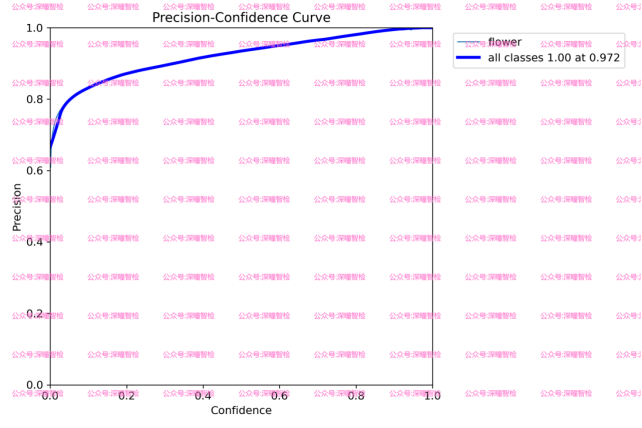

The deep blue line in the figure represents the overall accuracy, which increases with increasing confidence. At a fixed confidence level, the accuracy reaches 1.00. The other lines represent the accuracy at different confidence levels for each category.

Precision curve, aiding in analyzing the model's performance in detection tasks, particularly under different confidence settings. By this curve, appropriate confidence thresholds can be selected to optimize the model's detection results, balancing precision and recall.

3) PR_curve.png (Precision-Recall curve)

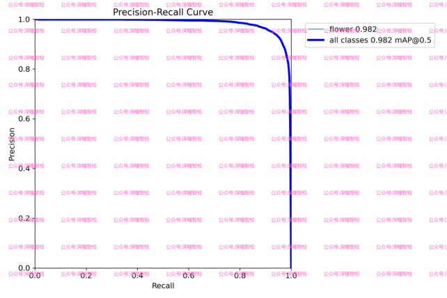

The curve in the image is a Precision-Recall Curve (Precision-Recall Curve), which shows the precision and recall of the classifier at different thresholds. Specifically, the horizontal axis represents Recall (recall rate), ranging from 0.0 to 1.0; the vertical axis represents Precision (precision rate), ranging from 0.0 to 1.0. The main curve in the image:

(1) The color lines represent the precision-recall curves of various categories, with varying degrees of precision for each category.

(2) The deep blue line represents the average precision-recall curve for all categories, with precision also maintaining a stable value around the maximum.

All these curves show a slight decrease in precision with an increase in recall rate, but the overall precision remains at a very high level.

This curve can evaluate the overall performance of the model in the target detection task and find an appropriate confidence threshold to achieve the best balance between precision and recall. The closer the PR curve is to the upper right corner, the better the model performs, and the larger the area under the curve, indicating that the model performs more stably at different confidence levels.

4) R_curve.png (Recall curve)

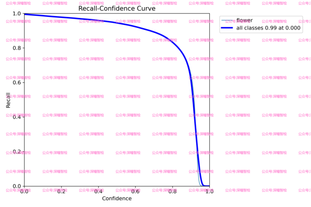

The R curve in the diagram represents the Recall-Confidence Curve (Recall-Confidence Curve), which shows the recall rate at different confidence levels. Specifically, the horizontal axis represents confidence levels, ranging from 0.0 to 1.0; the vertical axis represents recall rates, ranging from 0.0 to 1.0. The main curve in the diagram:

(1) Each color line: Represents the change in recall rate for each category as a function of confidence. This curve shows that, as confidence increases, the recall rate for each category initially changes less, then rapidly decreases after a certain point.

(2) Deep blue line: Represents the average recall rate of all categories with respect to confidence changes.

Display the recall performance of the model under different confidence thresholds. The recall curve aids in evaluating the model's ability to detect true targets in a target detection task. By examining this curve, users can assess the model's detection capabilities and analyze whether the model is comprehensively detecting real targets at varying thresholds. If the recall curve performs well at lower confidence levels, it indicates that the model can effectively detect most targets; if the curve declines rapidly, adjustments to the model or dataset may be necessary to avoid missed detection issues.

5) Results.png (Result indicator curve)

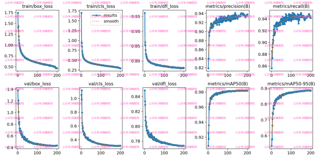

This image file shows the trend of key metrics (such as loss, mAP) during training.

box_loss: Position loss curve

Meaning: Bounding box loss, measuring the error between the predicted bounding box and the true one. Includes the center position, width, height, etc.

Chart: Typically displays the loss value curve on training rounds or steps, with lower values indicating more accurate predictions of bounding boxes by the model.

cls_loss: Classification Loss Curve

Meaning: Category loss, measuring the gap between predicted class labels and true class labels. Reflects the accuracy of the classifier.

Chart: Shows the loss value curve on training epochs or steps, with lower values indicating better classification performance.

dfl_loss: Target Detection Loss Curve

Meaning: Distribution Focal Loss, which addresses the issue of class imbalance in positioning tasks and helps the model focus more on the difficult-to-predict targets.

Chart: Shows the loss value curve on training rounds or steps, with lower values indicating better performance in distributed positioning tasks.

Precision(B): Precision curve

Meaning: Precision (B-class), indicating how many proportion of true positives are in the model's predicted positive samples. B-class usually refers to background class.

Chart: Shows the precision curve on training rounds or steps, with higher precision indicating higher accuracy in background class detection.

Recall(B): recall curve

Meaning: Recall rate (B-class), which represents the proportion of actual positive samples detected by the model. B-class usually refers to background classes.

Chart: Shows recall curves on training rounds or steps, with higher recall indicating stronger detection capabilities of the model for background classes.

mAP50(B): The average precision when the IoU threshold is 0.5

Mean accuracy (B class) at IoU threshold of 0.5, reflects the model's accuracy at this IoU threshold.

Chart: Shows the mAP50 value curve on the training epoch or steps, with higher mAP50 values indicating higher detection accuracy of background classes by the model.

mAP50-95(B): The average precision between 0.5 and 0.95 for IoU thresholds

Mean accuracy (B-class) within the range of IoU thresholds from 0.5 to 0.95, evaluating the detection performance of models under different IoU thresholds.

Chart: Shows the mAP50-95 value curve on the training epoch or steps, with higher mAP50-95 values indicating stronger overall performance of the model on background classes.

## 3. Inference phase

### 3.1 Starting the reasoning process

Predict using the trained model (input test image folder input_test_images):

Execute the following instructions:

python predict.py

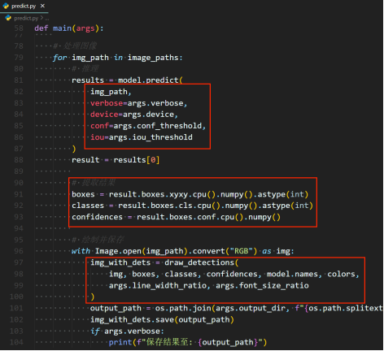

After the test is completed, the results are saved in the output_results folder.

### 3.2 Output Display

Output:

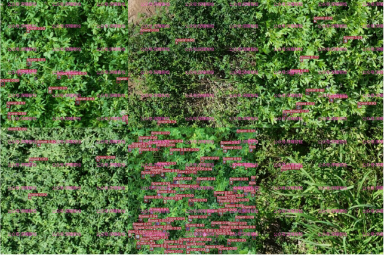

## 4. System UI interface

### 4.1 Implementing PyQt5 Code

Implement the interface code in ui_window.py and the logic code in ui_main_gui.py.

1) Running environment installation

Execute the following instructions:

pip install ultralytics==8.3.59 -i https://pypi.tuna.tsinghua.edu.cn/simple

pip install PyQt5==5.15.9 -i https://pypi.tuna.tsinghua.edu.cn/simple

pip install PyQt5-Qt5==5.15.2 -i https://pypi.tuna.tsinghua.edu.cn/simple

2) Set the model path

In the file ui_main_gui.py, specify the path of the optimal model that has been trained.

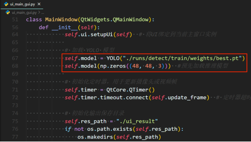

### 4.2 Final System Interface

Place UI test images/videos in the folder ui_test_files.

Execute the following instructions:

python ui_main_gui.py

Display as follows:

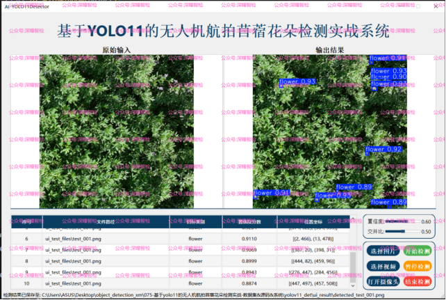

After the detection is completed (automatically), save the results in the ui_result directory (which will be created).

**Interface Features**:

1) Supports input sources such as images, videos, and cameras.

2) Confidence and intersection over union (IoU) parameters can be adjusted as needed.

3) Detection status (start/pause/end) can be set.

4) Comparison of original image and resultant image

5) Support real-time statistics display of table data.

6) Support for automatic data saving of results

## Payment

Here is a pay link on Stripe ( https://buy.stripe.com/3cs8yP7sY87d0vu9AB ). Please contact me lonlonago@foxmail.com after funding $89, and I will send you a complete data files , thank you!

